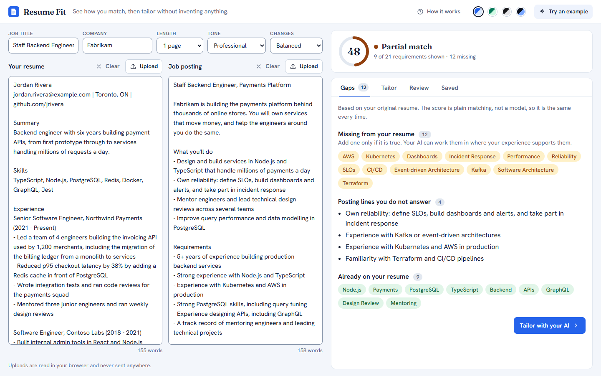
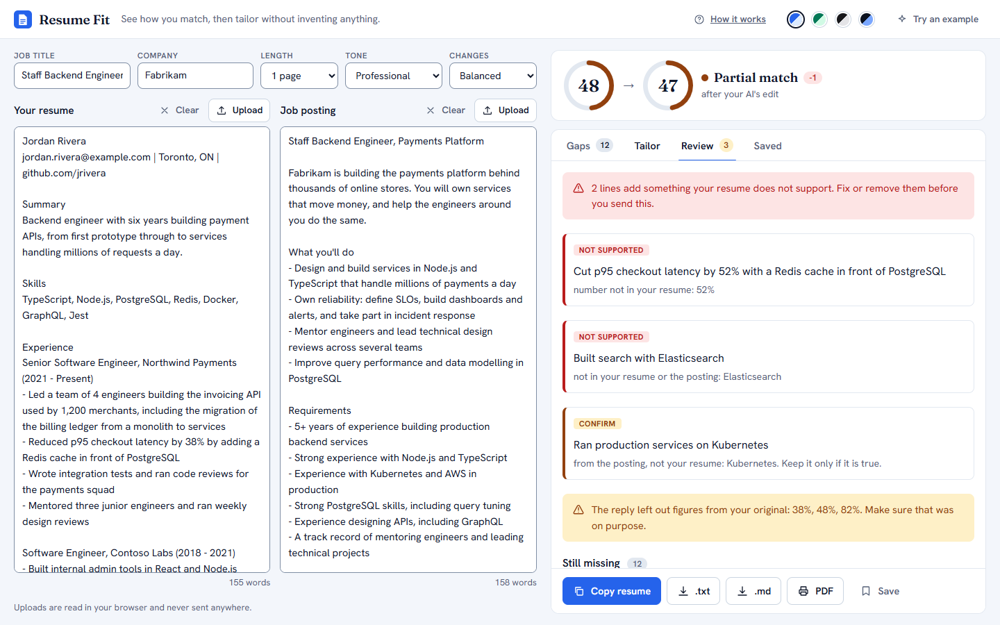
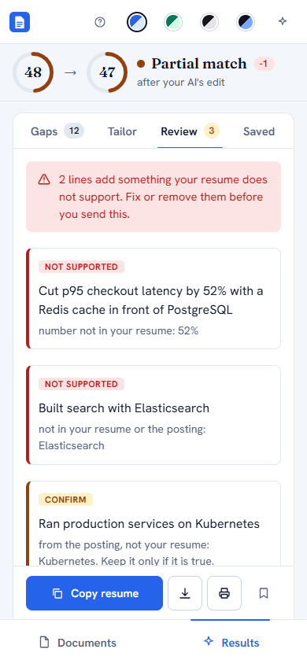

# Resume Fit

> Everybody wants me to pay for a resume filter, so I decided to make my own. Meet **Resume Fit**: a free, open-source tool that scores your resume against any job posting, shows what is missing, and helps you tailor it without making anything up.



Paste or upload your resume and a job posting. In a moment you see a **match score**, the requirements the posting asks for that your resume does not show, and the lines of the posting you never answer. Then tailor the resume with the AI you already use, and Resume Fit **checks the result against your original** so nothing invented gets through.

- **Free, and bring your own AI.** One click opens Claude, ChatGPT or Gemini with the prompt ready to paste. No API key, no account, no subscription to us.
- **It will not let the AI lie for you.** Every changed line is compared with your original. A new number, an employer, or a tool that is not in your resume gets flagged before you can send it.
- **Private by default.** PDF and Word files are read in your browser. The score and the check run on your device. No analytics.
- **See it work.** A [How it works](#how-it-works) page explains the score and the check, and its examples are computed by the real code.

<table>
  <tr>
    <td></td>
    <td width="220"></td>
  </tr>
</table>

## Quick start

You need Node.js 20.9 or newer.

```bash
git clone https://github.com/iamRed-One/resume-fit.git
cd resume-fit
npm install
npm run dev          # http://localhost:3000
```

Click **Try an example** to see everything working with a fictional resume and posting. You do not need an API key for any of it.

## What you can do

| Step | What happens | Needs a model? |
| --- | --- | --- |
| **Add** | Paste text, or upload a PDF, Word (`.docx`), `.txt` or `.md` file. Wrapped lines and bullets from PDFs are repaired. | No |
| **Score** | A match score from 0 to 100, what is missing, which posting lines you do not answer. The same input always gives the same score. | No |
| **Tailor** | Open your own AI with the prompt, or let the app's server do it (needs an API key). | Your AI, or Claude via the API |
| **Check** | Flags invented numbers and tools, skills to confirm, and figures the AI dropped. Re-scores the new version. Runs a six-part submission check. | No |
| **Use** | Copy it, download `.txt` / `.md`, print to PDF, or save a version for that job. | No |

### Two ways to tailor

| | **Your own AI** (default) | **Automatic** |
| --- | --- | --- |
| How | Click Claude, ChatGPT or Gemini; paste the reply back | One click; the server calls Claude |
| Needs | A chat AI you already use | `ANTHROPIC_API_KEY` |
| Check | Re-score, flag unsupported lines, note dropped figures | The same, plus automatic revert of bad edits, a change log, and a cover letter |

**About "opens with the prompt filled in":** Claude and ChatGPT accept the prompt in the link (`?q=`), but a resume plus a posting is usually too long for a link, so a long prompt is never squeezed into one. Every Open button also copies the prompt to your clipboard, so the dependable path is: click, then paste (Ctrl+V) into the empty box. Gemini has no prefill link, so it always works that way. Short prompts do arrive pre-filled.

## How it works

The short version is on the **How it works** page inside the app (`/how-it-works`). The longer one:

**The score is plain code, not AI.** The posting is cleaned of boilerplate (equal-opportunity text, pay, benefits, company blurbs). Requirements are found with a dictionary of about 510 skills and tools plus their other spellings (`k8s` is Kubernetes, `Postgres` is PostgreSQL), and a few rules for terms it does not know. They are weighted by where they appear: "Requirements" counts more than "Nice to have", soft phrases count less, and everyday words like "pipeline" only count in their own field. The score is the weighted share your resume shows.

**Tailoring is a request, so the result is never trusted.** The prompt tells the AI to use only facts from your resume. Because an AI can ignore that, every changed line is checked against the original: new numbers, employers, tools and names are flagged; a skill that only the posting mentions is held for your confirmation; another spelling of something you already show (`K8s` for `Kubernetes`) is accepted.

Read the code: the score is [`src/lib/keywords.ts`](src/lib/keywords.ts), [`skills.ts`](src/lib/skills.ts) and [`match.ts`](src/lib/match.ts); the check is [`grounding.ts`](src/lib/grounding.ts) and [`review.ts`](src/lib/review.ts); the prompts are [`prompt.ts`](src/lib/prompt.ts) and [`tailor.ts`](src/lib/tailor.ts).

## Privacy

- Uploads are parsed in your browser and never sent to a server.
- The score and the check run in your browser. There is no account and no analytics.
- With **your own AI**, what you paste goes to that assistant under its own privacy rules. A short prompt opened through a pre-fill link travels in the web address, so it can also appear in your browser history.
- **Automatic mode** is the only path that sends your resume and posting to this app's server, which passes them to the Claude API. Errors are logged by class and status only, never with your text.
- Saved versions and your colour theme live in your browser's local storage.

## Configuration

Copy `.env.example` to `.env.local`.

| Variable | Purpose |
| --- | --- |
| `ANTHROPIC_API_KEY` | Only for Automatic mode. A Claude.ai chat subscription does not include one; keys come from the Anthropic Console and are billed per token. |
| `ANTHROPIC_MODEL` | Optional. Defaults to `claude-opus-5-5`. |
| `NEXT_PUBLIC_REPO_URL` | Optional. Shows a "View the source" link on the How it works page. |

> **Before you deploy it publicly:** the API routes have no authentication or rate limiting, and every Automatic request spends your API credit. Add both first, or leave Automatic mode off by not setting a key. See [SECURITY.md](SECURITY.md).

## Interface

- **Desktop:** one screen with no page scroll. Options across the top, the resume and the posting side by side, and a results pane on the right with the score pinned at its top.
- **Phone and tablet:** one column, a score bar that stays at the top, and a Documents / Results switch at the bottom.
- **Four colour themes:** Ocean (default), Emerald, Graphite and a dark Midnight. A dark operating system starts on Midnight. Every colour is a token in `src/app/globals.css`.

## Scripts

| Command | What it does |
| --- | --- |
| `npm run dev` | Development server |
| `npm run build` / `npm start` | Production build and server |
| `npm test` | 84 unit tests. No network, no API key |
| `npm run typecheck` | TypeScript |
| `npm run eval:extract` | Keyword extraction against hand-labelled postings (needs the local data below) |
| `LIVE=1 npm run eval:live` | The real model on resume and posting pairs. Spends API credit |
| `npm run e2e:layout` `e2e:a11y` `e2e:contrast` `e2e:upload` `e2e:open-in` `e2e:auto` | Real-browser tests: layout and touch targets, accessibility, WCAG colour contrast, uploads, the Open-in-your-AI links, and the automatic screens against a faked server. Need the app running and Chrome or Chromium |

## Project layout

```
src/lib      the engine: matching, keywords, skills dictionary, grounding check, risk check, prompts, file extraction
src/app      the interface, the three API routes, and the How it works page
tests        unit tests (and a real PDF fixture)
evals        hand-labelled evaluation of keyword extraction, and a live model evaluation
e2e          browser tests (playwright-core, no browser download)
docs         screenshots
```

## Testing and accuracy

The engine is covered by unit tests, and the interface by browser tests that measure the layout, check keyboard use and touch targets, and compute colour contrast for every theme.

Keyword extraction is measured against hand-labelled job postings (see [`evals/README.md`](evals/README.md)). Treat the numbers there as optimistic: one person wrote the labels and the dictionary, and the dictionary was extended using postings that were also used for testing. The honest test is your own postings. The postings themselves are employers' text and are **not** in this repository; `node evals/fetch-postings.mjs` fetches them from public job-board APIs for local evaluation only.

The model calls have never been exercised in this repository's tests: they run against a fake. `LIVE=1 npm run eval:live` is there so you can measure the real thing with your own key.

## Known limits

- **Not a simulation of any employer's tracking system.** The score is a guide. It is tuned most for software roles and is thinner for other fields.
- **It cannot catch an overclaim in plain words**, like "led" where you only "contributed". It checks numbers, names and tools. Read the changed lines.
- **No OCR.** A scanned PDF has no text to read. Multi-column PDFs can come out in the wrong order.
- **No job posting by URL.** Fetching arbitrary links from a server is a security risk and many sites block it.
- **Export is `.txt`, `.md` and print-to-PDF.** No `.docx` yet.
- Saved versions live in one browser. No accounts, no sync.

## Contributing

Contributions are welcome. Read [CONTRIBUTING.md](CONTRIBUTING.md) first; the one rule that matters is that nothing may weaken the check that stops invented facts. Please also read the [Code of Conduct](CODE_OF_CONDUCT.md).

## License

[MIT](LICENSE).
